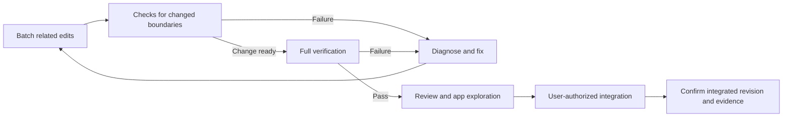

# Testing

Approach accepted, 2026-10-09 · DAG, affected selection and bounded concurrency verified · Autonomous promotion deferred

Implementation and measurement: [testing improvement plan](plans/testing-improvements.md) and [selection, presets and deduplication](plans/testing-selection-and-presets.md).

Verify observable behavior at stable boundaries and through real user journeys. Repository commands own execution and evidence so Codex and, later, Ash can use the same workflow. Reports are agent diagnostics; the human receives a concise outcome and targeted manual checks when their judgment is needed.

## Workflow at a glance

Follow the [check cadence](#when-to-run-checks) while editing, then verify the final candidate. Quick, focused and full verification are scopes of evidence, not three commands that must always run consecutively.

1. **Define the outcome.** Choose acceptance criteria before implementation. Each named scenario references stable IDs in feature specs or [workflow acceptance](development.md#workflow-acceptance); a passing scenario does not imply every clause of its linked requirement is covered.
2. **Choose the question.** Quick checks cover types and safety boundaries; focused checks cover selected behavior; full verification covers the implemented inventory. [Commands and selection](#commands) explain which setup accompanies a selection.
3. **Prepare an isolated environment.** Tests receive disposable databases, files and app state; the persistent preview remains separate. Code and installed dependencies may be reused. [Infrastructure](#infrastructure) owns the reuse guards.
4. **Run the checks.** Quick, focused and full scopes use the same select → optimize → run pipeline. The graph resolves type/build prerequisites, then schedules ready checks across suite boundaries under the shared worker limit. Exclusive lifecycle work runs alone. Existing test frameworks own their disposable environments; unconverted journeys remain explicit bundles.
5. **Validate the evidence.** Results must account for the selected scope, source must remain unchanged, and cleanup must succeed. A partial pass applies only to its selection. [Evidence rules](#evidence-and-handoff) define failures, interruption and retained diagnostics.
6. **Review and use the app.** Before handoff, the coding agent reviews the diff in a separate pass and explores the actual app. Report what works, what was verified and material limitations. Present targeted manual steps directly when needed, drawn from the selected procedures; do not ask the human to read a report. A reproducible bug becomes a regression scenario where useful. Integration follows the [delivery agreement](../specs/product.md#confirmed-engineering-agreement) and [Git requirements](development.md#git-integration).

## When to run checks

Run checks at coherent checkpoints, not after every edit or chat turn. Batch related edits, then choose the smallest scope that answers the current question. A check that cannot yet provide useful feedback can wait until its implementation is ready.

| Trigger | Check |
| --- | --- |
| Prose, comments or documentation links only | Review the diff and affected links; no runtime suite unless executable examples or behavior also changed. |
| Meaningful code, type or configuration changes | Quick checks at a coherent checkpoint; avoid repeating them for intermediate edits in the same batch. |
| Observable behavior changed, or a bug was fixed | Focused scenarios for that behavior and its affected consumers, including required group setup. |
| Verifier selection, scheduling, reporting, cancellation or recovery changed | Run `pnpm verify --group verification`; these self-checks are also retained in the full gate. |
| Affected selection is uncertain, including unfamiliar/shared changes or stale mappings | Run no tests automatically. Record selection as deferred with its reason; an explicit focused diagnostic remains available. Uncertainty does not trigger quick or full verification. |
| Final code candidate ready | Full verification on the frozen final candidate, including shared runtime, schema, dependency and verification changes. Prepare integration under the [Git requirements](development.md#git-integration). |
| A performance or reliability question needs repeated observations | Define a bounded comparison first; record failures and stop when that question is answered. Ordinary iteration does not require repeated timing runs. |

Reuse passing evidence while the checked behavior's implementation, fixtures, configuration and dependencies remain unchanged. Rerun when those inputs change, a relevant failure appears, or review leaves an unresolved concern. Do not rerun unaffected groups merely because more time or conversation turns have passed. Record the tested revision and scope; reused partial evidence does not become a full pass for a later revision. Documentation-only follow-ups retain the earlier code checkpoint and receive their own document checks.

An authorized fast-forward of the exact verified commit reuses that full report after confirming the revision and verification inputs. Rebasing or resolving conflicts creates a new candidate that needs its own final gate.

Freeze the candidate, base revision, dependencies and fixtures for a verification run; do not follow a moving `master` while gathering evidence. After a full-run failure, retain the report and isolate the cause with a focused reproducer before another full run. Distinguish application failures from fixture, environment and source-change failures, fix the cause, and check that path narrowly. Run the next full gate only when the diagnosis supports it. Serial execution requires evidence of a concurrency problem; it is not a blanket response to a timeout.

Choose a bounded diagnostic question before adding runs. If verification exceeds the task's expected time, report the cause and next focused check instead of stacking broad reruns. A dependency batch should normally need one final full gate plus any justified focused diagnostics.

Exclude confirmed sleep/resume interruptions from performance comparisons, retaining their failures and cleanup evidence. Resume measurements only with an awake, unlocked desktop session. Idle-sleep prevention does not override forced or lid-related sleep.

## Verified baseline

Revision `8a9650c`, macOS arm64, 2026-10-09: full automated verification passed all 20 scenarios, including cleanup. The user confirmed the `desktop-experience` manual check passed: disposable preview, editing, compact mode, resizing, keyboard focus, app/Spaces switching and shutdown with the persistent preview preserved. This establishes the initial local baseline; future relevant changes still require the checks below.

## Coverage policy

- No routine unit-test requirement or line-coverage target. Prefer integration tests over implementation-shaped mocks. Retain small invariant checks where they cheaply protect filesystem isolation, credentials, locking or process ownership.
- Integration tests use real internal components, including PostgreSQL and filesystem state. Substitute controlled adapters at external boundaries. Test invalid input, retries, interruption and recovery as well as success.
- Scripted E2E tests and agent exploration use the hidden [background mode](development.md#startup-and-process-ownership); add `--background` when exploring with `pnpm dev:verify`. Reserve visible windows for user-facing demonstrations or native-window checks and announce them before opening. Seed through fixture infrastructure; do not bypass the operation under test with direct state edits.
- UX checks include keyboard access, focus, visible status, draft preservation, scrolling and supported window sizes as relevant. Automated accessibility checks complement interaction testing when added.
- Visual comparisons detect changes against reviewed baselines. Agent exploration evaluates clarity and design quality against the intended experience. Keep these judgments distinct from deterministic passes.
- Write short manual procedures for critical flows and native behavior. Do not require a human to inspect reports or repeat every automated check.

## Commands

Run from the checkout root. Docker and an awake, unlocked graphical macOS session are required for workflow and desktop suites; quick checks need neither Docker nor Electron. Process inspection and writes to the development evidence directory still require appropriate host permissions. Verification defaults to six shared worker slots; `--workers` accepts integers from 1 through 12. The [scaling comparison](plans/testing-selection-and-presets.md#worker-scaling) supports six on the measured host; higher counts remain experimental. Child runners use one each, and lifecycle checks reserve the whole capacity.

| Command | Scope |
| --- | --- |
| `pnpm verify` | Full: types, isolated build, boundary checks, real-worktree lifecycle checks and desktop scenarios. Required before integration. |
| `pnpm verify --profile quick` | Types, fast module checks and storage/process/environment guards for iteration; reported as partial verification. Verifier self-checks run with `--group verification` or in full verification. |
| `pnpm verify --scenario chat-layout` | Types, build and only the independent layout scenario. |
| `pnpm verify --group model-routing --scenario model-routing-desktop` | Types, build, routing integration and its desktop scenario; the two ready execution units may overlap. |
| `pnpm verify --scenario DEV-07` | Types, build and complete execution groups containing checks linked to DEV-07. |
| `pnpm verify --workers 1` | Serialize feature groups and desktop files for diagnosis or comparison; lifecycle groups always run alone. |
| `pnpm verify --workers 2` | Lower the shared worker limit for a contended host or a comparison. |
| `pnpm verify --timing normal` | Use normal scheduling in disposable test instances for comparison. |
| `pnpm verify --list` | JSON scenario inventory with group/file expansion; combine with profile/scenario/group selection. No resources are provisioned. |
| `pnpm verify --affected HEAD~1 --iterate --list` | Preview the affected iteration scope and execution graph, including working/staged/untracked changes, reasons, prerequisites and approximate timing. No development root or resources are created. |
| `pnpm verify --affected HEAD~1 --iterate` | Run a known affected selection. Uncertainty defers with exit code 2, no tests/provisioning and `passed: null`; no relevant checks exits 0 with `not-needed`, also without claiming a pass. |
| `pnpm verify --affected HEAD~1` | Intentionally execute the final full gate and record its advisory selection. Omit `--iterate` only when full verification is intended; `--list` previews that full scope. |
| `pnpm verify --scenario chat-layout --reference /path/to/report.json` | Estimate from a passing report for matching platform, architecture and timing profile. Available for every scope. Default history uses a saved local full report, or an initial partial report until a full one exists. This reuses timings, never test passes. |
| `pnpm test:audit --since HEAD~1` | Check inventory integrity and suggest duplicate/shared-setup candidates involving changed test files. Advisory candidates require semantic review. `--all` scans the whole inventory. |
| `pnpm test:boundary`, `pnpm test:workflow`, `pnpm test:desktop` | Direct suite commands for debugging; `pnpm test` aliases the boundary suite. Use `verify` for an aggregate report. |
| `pnpm dev:verify --fixture scratchpad --deterministic` | Fresh offline disposable app for exploration/manual checks; Ctrl+C stops and disposes it. For live exploration, use the [bounded model options](features/threads.md#openai-mode). |

Comma-separated scenario/requirement IDs and group names select their union. Unconverted integration groups remain opaque ordered bundles; selecting one member expands to that executable bundle. The four extracted chat/image/video desktop cases and existing desktop scenarios can run independently. `tests/scenarios.ts` owns canonical membership and current adapter metadata. The graph explicitly labels legacy bundles, Node cases and Playwright batches; a batch contains only selected cases. Reports distinguish partial from full verification; missing results, unexpected results, skips and failed attempts fail the run. [Execution design and rollout](plans/testing-selection-and-presets.md#select-optimize-and-run). Renderer-release journeys run alone because they build and check multiple full-artwork apps concurrently.

Affected selection covers audited Markdown-presentation and model-routing components. It checks both diff paths for moves/deletions, static relative imports, declared consumers and reviewed expansion budgets. Missing ownership, stale declarations, new consumers/dependencies or exceeded budgets defer automatic iteration; known subsets do not run alongside unresolved paths. Other dependency forms and complete transitive behavior are not modeled. `selection.json` explains inclusions and uncertainty; the compatibility field `fallback` contains deferral reasons, never a request for an automatic full run. The [selection plan](plans/testing-selection-and-presets.md) owns rollout and acceptance criteria; the final full gate remains authoritative.

The verifier records its worker count and timing profile. Direct suite commands default to one worker and normal timing. Accelerated timing is admitted only in disposable `test` instances using the deterministic model. It shortens synthetic visibility deadlines, debounce and scheduler intervals; assertion timeouts retain their normal margin. Preview/verification instances use normal timing. The controlled OpenAI protocol group explicitly uses normal timing because it exercises live-session configuration. Deadline boundary integration tests retain their injected clock. See the [improvement plan](plans/testing-improvements.md) for measurement targets and evidence.

## Infrastructure

| Path | Responsibility |
| --- | --- |
| `tests/scenarios.ts` | Scenario IDs, requirement references, suite/fixture metadata and authored manual procedures. No duplicate product rules. |
| `tests/support/desktop.ts` | Shared Electron launch and authenticated backend inspection. |
| `tests/support/fixtures.ts` | Fresh instance per desktop test, diagnostic capture and disposal. |
| `tests/support/presets.ts` | Deterministic API recipes for declared starting states; validates populated history before Electron starts. |
| `tests/support/node-scenarios.ts` | Dispatch registered Node cases and record outcomes without replacing the test runner; unselected callbacks never execute. |
| `tests/support/playwright-reporter.ts` | Playwright outcomes, attempts and artifact references, including fixture failures. |
| `tests/boundary/` | Fast ownership invariants and verification CLI contract checks. |
| `tests/integration/workflow.test.ts` | Ordered lifecycle journey across real detached worktrees and isolated infrastructure. |
| `tests/e2e/`, `tests/playwright.config.ts` | Playwright Test scenarios against Electron; bounded file concurrency, no automatic retries. |
| `tests/baselines/` | Versioned screenshot expectations. |
| `scripts/dev/verify.ts` | Selection, progress, command execution, source validation, recovery cleanup and aggregate evidence. |
| `scripts/dev/graph.ts`, `scripts/dev/graph-report.ts` | DAG validation, resource-bounded scheduling, historical timing and the execution timeline. |
| `scripts/dev/selection.ts`, `scripts/dev/audit-inventory.ts` | Explain reviewed affected selections, flag mapping/inventory drift and suggest similarities for review. |
| `scripts/dev/test-workflow.ts` | Bounded feature concurrency followed by exclusive renderer-release and lifecycle groups. |
| `scripts/dev/telemetry.ts` | Phase/scenario events and ownership records for disposable resources. |
| `scripts/dev/product-database.ts`, `tests/helpers/migrations.ts` | Guarded reuse of completed test migrations and real database failure/recovery checks. |
| `tests/support/ui.ts`, `tests/support/electron.ts` | Polling-safe route teardown, reload fixtures, live inspector controls and tracked Electron launches. |

Reuse the [instance lifecycle and data isolation](development.md#workspace-and-instance-identity). Test instances never reset the persistent preview. Ordinary desktop tests dispose their own instances while retaining the shared development database service. The infrastructure lifecycle suite owns and removes its separate temporary cluster.

Fresh provisioning supplies `blank_slate`. Scenarios may declare `conversation_ready` and its input text in the registry; the recipe constructs a real completed exchange and captured request in that test's own instance. It refuses live providers, existing conversations/Topics and non-test instances. Each consumer gets fresh data and credentials. Drafts, focus and scroll remain explicit UI preconditions; layout baselines select their intended initial scroll mode through real input. There is no snapshot cache or shared mutable app. New sends, persistence, streaming and recovery behavior under test must still run live.

Quick verification checks executable definitions against the inventory and exercises selection drift through temporary Git checkouts. Duplicate suggestions compare changed tests with the inventory; body fingerprints remember reviewed distinctions until code changes. The heuristic can miss duplicates and cannot establish behavioral equivalence. Review related behavior when adding/changing a scenario, and use broader audits when a family grows or is refactored.

Fresh databases execute bootstrap and product migrations in one CLI deployment, then receive their own identity, fixture rows and grants. Initialization requires an owned database with an empty public schema; existing pre-Prisma databases retain separate baseline resolution. Failed provisioning remains disposable through the recorded database/role ownership.

Disposable test startup avoids a repeated migration CLI launch only after a successful deployment in the same process, with unchanged schema, migration SQL, migration lock and dependency lockfile, and an exact database history match by name, checksum and completed status. Database identity checks, seed preservation and runtime grants still execute. New processes, provisioning, explicit migration checks and preview/verification instances always use the CLI; changed, missing, failed or rolled-back history takes that path too. There is no persistent receipt or shared mutable database. `workflow-migrations` exercises fresh initialization, reuse, invalidation, failure recovery and reset in a disposable source checkout.

Disposable `test` instances disable hot reload. Svelte 5.55.7's HMR wrapper can collect the same transition twice, leaving a reopened inspector outside the viewport; [upstream fix](https://github.com/sveltejs/svelte/pull/18655). Feature checks retain real motion and pointer actions. Preview/verification profiles retain hot reload, exercised by the exclusive lifecycle group. Revisit this configuration when upgrading Svelte.

Startup overlaps backend readiness, frontend-tool loading and source fingerprinting. The frontend listener waits for those prerequisites. A failed preparation drains launched work before shutdown, so a late backend cannot escape cleanup; `workflow-crash` exercises that failure and subsequent recovery. Startup evidence separates `services.bootstrap`, `services.backend`, `services.modules`, `services.frontend` and `source.fingerprint` within the existing readiness spans.

Keep network fault-injection routes installed during polling scenarios and switch their response behavior. Toggling Electron request interception can abort unrelated requests in flight and turn a simulated failure into a test-harness failure. After navigation or archive commands, await the destination, restored draft and settled archive state before using the new controls.

For the filesystem access-evidence limit check, poll only persisted Run status while the 512-check payload grows; read and validate the complete evidence after settlement. Repeated full-thread reads compete with the operation's real deadline. Keep the 513-file traversal, 30-second fixture deadline and saved-evidence assertions intact.

Upload rejection fixtures check declared length and actual chunked bytes separately and consume the HTTP response. Bulk `fetch` writes can surface a socket error after an early size rejection. Require the real 400/413 response and unchanged attachment count; never accept connection errors or retry a failed attempt as a pass.

Desktop scenarios assert that hidden windows remain invisible and non-focusable through interaction, resize and reload, then exercise keyboard message submission, persisted threads, drafts, sidebar preferences and Artifact inspection after reopening, plus thread screenshots at 1040×830 and 740×650 content sizes. Workflow checks retain database/file isolation, reset, crash recovery, hot reload and disposal coverage. The thread, image and mocked OpenAI integration checks are registered in the scenario inventory; boundary checks also run the existing context, storage and model tests.

## Design requirements

Frontend changes must identify affected [DS-R requirements and DS-V acceptance scenarios](../specs/design-system.md). Hard requirements need observable checks, automated where reliable and explicit manual checks where necessary. Experiential principles need real-app review against Final; optional/deferred refinements do not block delivery. Record actual coverage and gaps in the [design implementation](features/design-system.md#verification-coverage).

Check motion separately from reduced-motion screenshot baselines. Wait until the renderer observes reduced motion before triggering an action; verify zero animation duration separately from asynchronous animation-object cleanup. Exercise popup/dialog focus, reversal, editing and streaming continuity, native fallbacks, varied scenes and stacked glass where affected. Retain existing feature checks. A screenshot match is not evidence of contrast, keyboard behavior or performance. During replacement, query the live named region or accessible roles; text-only queries can also match inert visual copies. For reversal from a fully open state, await settled content as well as material.

## Visual expectations

Playwright Test compares screenshots with `updateSnapshots: 'none'`; a missing baseline fails. Baselines are partitioned by OS and architecture, with Electron/Playwright pinned in the lockfile. Match OS version, display scale and fonts when comparing; a new environment needs its own reviewed expectations. Initial baselines cover macOS arm64 only.

Static layout scenarios use reduced-motion mode to avoid entry/stream animation timing; integration scenarios cover motion and scrolling. The desktop test helper sets macOS `AppleShowScrollBars=Always` through the [process argument domain](https://developer.apple.com/library/archive/documentation/Cocoa/Conceptual/UserDefaults/AboutPreferenceDomains/AboutPreferenceDomains.html#//apple_ref/doc/uid/10000059i-CH2-SW4), preserving baseline geometry without changing user preferences. Preview identity text is normalized, and variable response timing/thread age are hidden by `tests/support/visual.css`. Product colors remain unchanged in screenshots. The background desktop scenario checks the displayed identity against the API; the workflow identity scenario checks branch creation, rename and detached HEAD without changing instance ownership. The remaining thread layout and content are real. These screenshots do not cover the hidden metadata; interaction tests cover its behavior. Reviewed images record the current implementation, not human approval of its design.

For an intentional visual change:

1. Run `pnpm test:desktop --update-snapshots` explicitly.
2. Inspect changed images and explain the intended design change. Do not regenerate expectations merely to make a failing check pass.
3. Run `pnpm verify` with baseline updates disabled on the final source.

Electron automation is [experimental](https://playwright.dev/docs/api/class-electron). Screenshot comparisons have [environment sensitivity](https://playwright.dev/docs/test-snapshots). Native focus, Spaces, window management and subjective design quality still need exploration/manual judgment.

## Evidence and handoff

Each verification session prints an evidence directory outside disposable state. It retains `report.json`, `checks.log`, scenario records, screenshots, action traces, cleanup diagnostics and, when relevant, `manual-plan.md`. Direct desktop runs use ignored `out/verification` output relative to the test configuration and may replace previous direct-run artifacts.

Desktop runners own separate `desktop/<node-hash>` output roots; direct runs use `desktop/direct`. Playwright clears its output root at startup, so concurrent nodes must never share that root. Scenario artifact paths in the report resolve within the evidence directory.

`plan.json` freezes the selected execution graph and timing reference; `progress.json` records its states and owned environment IDs. `timeline.html` visualizes actual overlap, dependencies and approximate remaining time, refreshing while work runs. Preparation counts stay separate from scenario counts. Timings use one passing reference report, with sample count and source recorded; variability remains unmodeled and missing durations stay unknown. Planner overhead and final prediction error appear in the aggregate graph record. `~/.ash-dev/verification-reference.json` stores the default report pointer; it is timing history, not cached verification evidence.

Reports identify source commit and content fingerprint, lockfile, runtime versions, fixtures/schema, model mode, selected scope and command/scenario outcomes. Version 2 adds end-to-end duration, worker/timing configuration, timestamped phase/scenario events and recovery cleanup outcomes. Phase spans may nest or overlap; use timestamps rather than adding them to infer elapsed time. Progress streams as scenarios and setup phases execute. Resource recovery uses recorded instance ownership, process start identities and session-scoped checkouts/clusters; cleanup failure still fails verification. The fingerprint covers code, tests, baselines, specs, engineering docs and workflow configuration, including uncommitted additions/deletions. A changed source invalidates the session even if tests pass; verification does not freeze files or detect every transient edit reverted before the final fingerprint. Keep source unchanged while verifying. Recheck the integrated revision after merge.

Setup diagnostics separate migration CLI execution (`database.deploy`) from current-history inspection (`database.current`), and Electron bundling (`desktop.bundle`), launch (`electron.launch`) and UI connection (`desktop.connected`). An expected migration-failure probe can record a failed phase inside a passing scenario; command and scenario outcomes determine verification status.

Missing selected results are blocked; omitted scenarios are not-selected; failed attempts remain failures even if a retry passes. Cleanup failure fails its suite. Human checks remain pending and agent review remains unrecorded until separately performed; an automated pass makes no claim about either. Reports are local diagnostics, not tamper-resistant attestations.

Only synthetic data is allowed. Logs redact credential-shaped fields; runtime configuration is never copied into evidence. Desktop traces retain actions/screenshots with network/DOM snapshots and source capture disabled to avoid recording authenticated requests. Review any new diagnostic capture for secret leakage. Forced termination may leave owned resources for recovery; never claim successful cleanup without evidence.

The [workflow overview](#workflow-at-a-glance) owns the handoff sequence; an automated report alone does not complete it.

## Product and self-modification extensions

The deterministic adapter covers streaming, controlled delay, failure and cancellation while internal persistence/context processing remains real. Product coverage and remaining acceptance gaps live in the [chat test plan](plans/persisted-chat-tests.md) and [image test plan](features/images.md). Mocked Responses checks run offline; live-model usefulness is evaluated separately. [OpenAI mode](features/threads.md#openai-mode) keeps ordinary interactive sessions uncapped and optional live tests bounded. Exhausting a live budget does not stop offline verification.

The approved [inspectable tools test plan](plans/inspectable-tools-tests.md#automated-scenarios) covers shared dispatch and feature-specific handlers. The scenario inventory lists the checks available in this checkout; generic execution/provider tests do not require filesystem or Topic implementations.

Recovery verification follows [backup and recovery](data-model.md#backup-and-recovery): restore a physical backup plus archived WAL into a separate PostgreSQL instance, verify state at the chosen time with zero external calls, and check startup interruption handling separately.

Ash can invoke the same commands and attach reports to Runs and Decisions. [Local renderer application](features/adapt.md#local-application) adds a fixed protected verifier outside candidate-controlled source. Broader code promotion still requires protected required checks and explicit review of changed tests, baselines and verification policy. The candidate cannot establish trust by modifying its own pass criteria. A separate reviewer helps but does not enforce that boundary.

Broader promotion must reference the exact verified revision and migration/recovery evidence. Passing tests does not authorize replacing the running product. Execution isolation, rollout authority and rollback remain G08/G10; Git rollback alone cannot reverse a database migration. Hosted CI, live providers, broad impact analysis and autonomous source integration remain outside the scenario harness.
